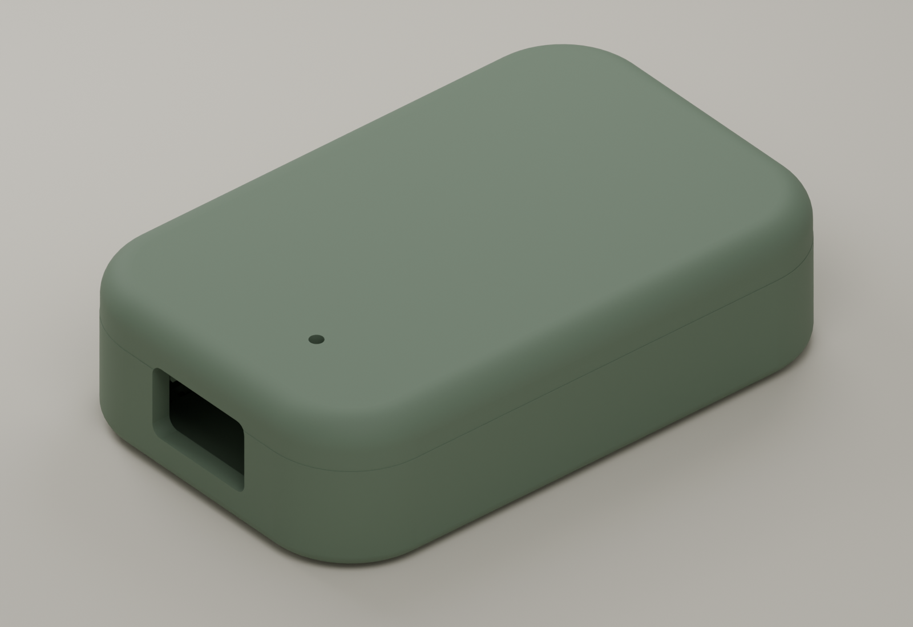
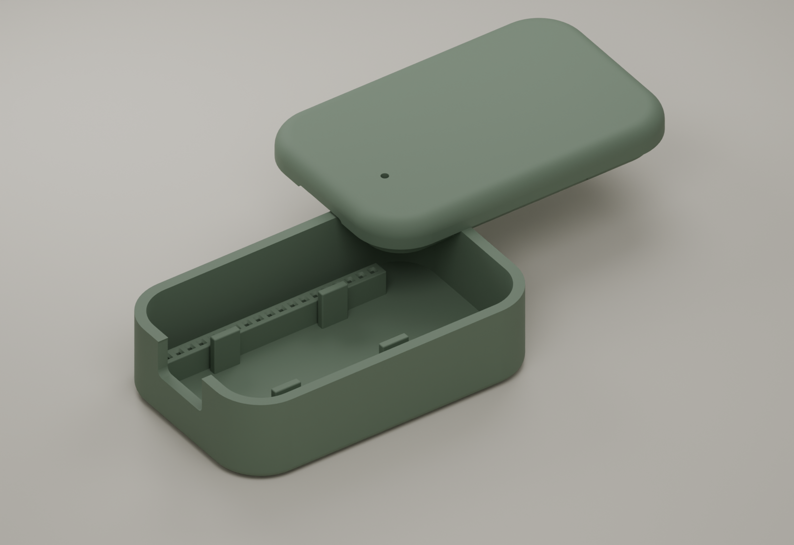
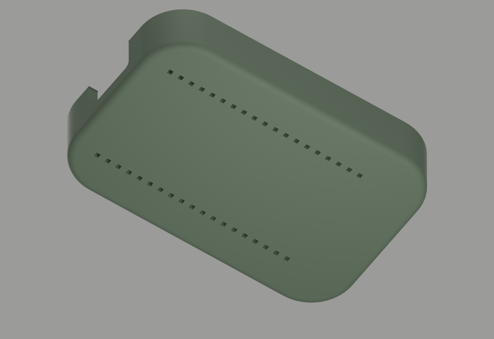

# DevKitC V4 enclosure

A rounded, matte olive case for the ESP32 DevKitC V4, with a removable friction-fit lid, a recessed Micro-USB opening, 38 individual blind header-pin sockets, and one 1.6 mm top aperture. There is no display, strap, magnet, battery compartment, or extra electronics.

The board slides into the pin grid from above. Four insulating seats support its underside between the header rows. The pin fit locates the board; the lid has a registration lip and four small friction ribs. The pins sit inside closed sockets; the underside is solid. Raised rails provide 6.2 mm of socket depth above a 1.2 mm bottom skin. The board sits higher to enclose its existing pins.

**This is a dimensioned first-print design. It has not been physically fitted or printed.** The user's board photos and printer tolerances still need checking. The top aperture is provisionally positioned for the power LED; its exact location is adjustable in the source.

## Files

- [Editable Blender model](../hardware/enclosure/ewp-devkitc-v4.blend)
- [Base STL](../hardware/enclosure/ewp-devkitc-v4-base.stl)
- [Lid STL, already oriented for printing](../hardware/enclosure/ewp-devkitc-v4-lid.stl)
- [Full 38-pin fit test](../hardware/enclosure/ewp-devkitc-v4-pin-fit-test.stl)
- Small tolerance tests: [0.85 mm](../hardware/enclosure/ewp-pin-tolerance-0.85.stl), [0.95 mm](../hardware/enclosure/ewp-pin-tolerance-0.95.stl), [1.05 mm](../hardware/enclosure/ewp-pin-tolerance-1.05.stl)
- [Parametric Blender generator](../hardware/enclosure/build_enclosure.py)
- [Mesh validation report](../hardware/enclosure/geometry-checks.json)

All STL coordinates are in millimetres. The Blender scene also displays millimetres. Reference board geometry is in a separate, hidden collection and is excluded from exports.

## Dimensions and sources

| Feature | Dimension | Basis |
| --- | --- | --- |
| PCB | 48.26 × 27.94 mm | Espressif dimension drawing |
| Header count | 2 × 19 | Espressif layout and pin tables |
| Header pitch | 2.54 mm | Espressif dimension drawing |
| Header row separation | 25.40 mm | Espressif dimension drawing |
| First pin from USB PCB edge | 1.29 mm | Espressif dimension drawing |
| Antenna overhang | 6.04 mm | Espressif dimension drawing |
| Outside of assembled case | 66.8 × 42.8 × 22.4 mm | This design |
| Base floor / nominal side wall | 2.2 / 2.2 mm | This design |
| Nominal square blind socket | 0.95 mm, with tapered entry | First-print assumption |
| Blind socket depth / bottom skin | 6.2 / 1.2 mm | This design |
| Top aperture | 1.6 mm diameter | First-print assumption |
| USB cable opening | 14 × 8.4 mm, rounded corners | Cable clearance assumption |
| Lid lip clearance | 0.20 mm per side | First-print assumption |

Manufacturer references: [DevKitC V4 dimension drawing](https://dl.espressif.com/dl/schematics/esp32_devkitc_v4_dimensions.pdf), [DevKitC V4 guide and component layout](https://documentation.espressif.com/esp-dev-kits/en/latest/esp32/esp32-devkitc/user_guide.html).

The reference PCB thickness (1.6 mm), header housing height (2.5 mm), nominal square pin section (0.64 mm), solder clearance, module height, USB envelope, and LED coordinates are modelling assumptions. Confirm them against the physical board, especially for clones or replacement USB connectors. The case includes the antenna overhang and keeps it free of metal inserts.

## Print and fit

1. Print a small tolerance coupon first. Choose the square-hole size that accepts both pin rows with a light push. The default is 0.95 mm; the other coupons are 0.85 and 1.05 mm.
2. Print the full 38-pin test to check the entire grid, row spacing, and the straightness of the headers.
3. If either test binds, change `--pin-hole` and regenerate the base. Do not force the board into a tight grid.
4. Print the base and lid in their exported orientations. A starting setup is a 0.4 mm nozzle, 0.2 mm layers, four perimeters, five top/bottom layers, and 20% infill. PETG is the intended material; PLA can be used to check dimensions.
5. Deburr the blind sockets and USB opening. Seat the board, check cable access, then press the lid on. Check the LED aperture before treating the design as final.

The lid is exported with its broad outer face against the bed, so the inner lip prints upward. Its shallow curved edge may show bed texture or a slight step; inspect your slicer's first-layer contact and overhang preview. Supports are not intended for the shell, but the slicer preview and a first print must confirm that for your printer. Fit and long-run operating temperature are unverified.

## Regenerate in Blender

Tested with Blender 5.2.3 LTS. Run from any directory; output stays in the directory you specify:

```sh
blender --background --python-exit-code 1 \
  --python hardware/enclosure/build_enclosure.py -- \
  --output artifacts/enclosure --pin-hole 0.95 --render
```

Use `--light-x` and `--light-y` to move the top aperture. The board length runs along X, USB toward negative X, antenna toward positive X. The PCB centre is X = -4.5 mm, Y = 0; the bottom of the case is Z = 0.

Run `python hardware/enclosure/verify_stl.py` to check the delivered STLs independently of Blender. It checks closed edges, consistent winding, connected solids, bed placement, and blind socket counts and a solid underside using sections above and below the socket bottoms.

The generator checks every exported part for manifold edges, positive volume, and one connected component. These checks establish mesh integrity; they do not establish physical fit, strength, printability, or radio/thermal performance.

## Views

Assembled exterior:



Open shell:



Solid underside:


