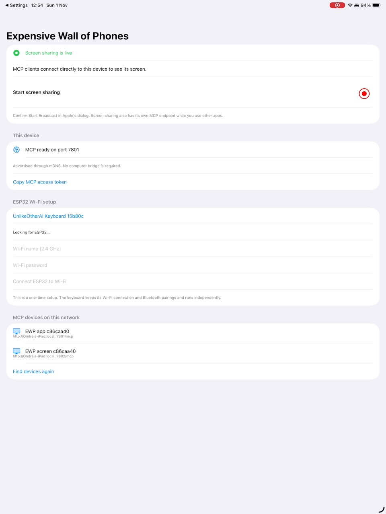

# Direct device verification

Tested on 1 November 2026. The archived [31 October prototype report](verification-20261031.md) describes the superseded computer-bridge design.

## Current implementation

The ESP32 hosts its own authenticated HTTP MCP endpoint on port 80. The iOS app hosts its own endpoint on port 7801; its ReplayKit extension hosts screen MCP on port 7802 while broadcasting. Each advertises `_mcp._tcp` with its role and device ID. Discovery never publishes credentials. No computer forwards runtime MCP requests or frames.

The app can discover keyboards, select one, provision Wi-Fi, report status, request screen sharing, capture its screen, and stop sharing through MCP. Apple still requires its system broadcast confirmation. Background screen access belongs to the broadcast extension; the foreground app listener recovers when the app returns.

The keyboard exposes pairing, saved-host selection, keyboard input and pointer input. Bonds and the selected host are persisted in ESP32 NVS. A target that has not reconnected leaves input unavailable rather than sending it to another host. Initial Bluetooth pairing uses the target's system settings.

## Evidence

| Check | Host / source | Result |
| --- | --- | --- |
| Portable tool tests and enclosure checks | Windows Maxis, `0ccab44` | Passed; physical endpoint tests and POSIX permission checks were skipped in the Windows run. |
| Tool privacy and error checks | macOS | Six focused tests passed, including private-file permissions. |
| ESP32 firmware compilation | Windows Maxis, `bf56edb` | Passed; 59,044 bytes RAM and 1,120,861 bytes flash. |
| ESP32 provisioning | Physical ESP32-D0WDQ6, USB setup | Wi-Fi connected; device-hosted MCP and keyboard-role mDNS discovered. |
| ESP32 direct MCP | Physical board, actual Python MCP SDK | Initialization, six tools, status and pairing command passed. |
| iOS build, install and launch | Mac / physical iPad and iPhone, `0ccab44` | Passed with development signing. |
| iPhone rendered layout | Existing iPhone 16 Pro Max simulator, `0ccab44` | Passed; simulator evidence only. |
| iPad native MCP and capture | Physical iPad Air 13 M3, `0ccab44` | Two direct screen acceptance tests passed, including real JPEG decoding and missing-token / browser-origin rejection. |
| Broadcast initiation | Physical iPad | MCP opened Apple's Start Broadcast dialog; the paired developer UI tool confirmed it. |
| Capture while another app is foregrounded | Physical iPad, `366da1a` | Direct screen MCP remained live with Settings foregrounded; decoded a fresh frame after 20 seconds. App MCP recovered on return. |
| Bluetooth keyboard input and saved-host switching | Physical iPad / iPhone | Still under verification. The first connection exposed a subscription-before-authentication race, corrected in `0039ce8`. No physical input or A → B → A success is claimed yet. |

The temporary XCTest control harness is a development tool for paired USB device setup and system dialogs. Product MCP endpoints run on the devices and do not depend on that harness.

## Changed screens

The repository's primary branch has no prior app page. Images below show the new direct-device page. No credentials, pairing PINs or personal Settings screens are published.

| Before | After |
| --- | --- |
| New iPad setup page; no prior equivalent. Physical iPad. |  |
| New iPad live-sharing state; no prior equivalent. Physical ReplayKit capture. |  |
| New iPhone setup page; no prior equivalent. Simulator. |  |

Keyboard delivery, automatic reconnection, persistence across reboot and pointer delivery require separate physical proof. Successful builds, Bluetooth advertisements and accepted notification calls do not establish those outcomes.
