# Direct device verification

Tested on 1 November 2026. The archived [31 October prototype report](verification-20261031.md) describes the superseded computer-bridge design.

## Current implementation

The ESP32 hosts its own authenticated HTTP MCP endpoint on port 80. The iOS app hosts its own endpoint on port 7801; its ReplayKit extension hosts screen MCP on port 7802 while broadcasting. Each advertises `_mcp._tcp` with its role and device ID. Discovery never publishes credentials. No computer forwards runtime MCP requests or frames.

The app can discover keyboards, select one, provision Wi-Fi, report status, request screen sharing, capture its screen, and stop sharing through MCP. Apple still requires its system broadcast confirmation. Background screen access belongs to the broadcast extension; the foreground app listener recovers when the app returns.

The keyboard exposes pairing, saved-host selection, keyboard input and pointer input. Bonds and the selected host are persisted in ESP32 NVS. A target that has not reconnected leaves input unavailable rather than sending it to another host. Initial Bluetooth pairing uses the target's system settings.

## Evidence

| Check | Host / source | Result |
| --- | --- | --- |
| Portable tool tests and enclosure checks | Windows Maxis, `0ccab44` | Passed; physical endpoint tests and POSIX permission checks were skipped in the Windows run. |
| Tool privacy and error checks | macOS | Six focused tests passed, including private-file permissions. |
| ESP32 firmware compilation | Windows Maxis, `bf56edb` | Passed; 59,044 bytes RAM and 1,120,861 bytes flash. |
| ESP32 provisioning | Physical ESP32-D0WDQ6, USB setup | Wi-Fi connected; device-hosted MCP and keyboard-role mDNS discovered. |
| ESP32 direct MCP | Physical board, `bf56edb`, actual Python MCP SDK | Two endpoint acceptance tests passed: authentication / browser-origin rejection, initialization, six tools, status and unknown-tool handling. Pairing command also passed. |
| mDNS discovery | macOS Bonjour and physical iPad app | App, screen and keyboard roles discovered. The iPad resolved the ESP32 endpoint directly. |
| iOS build, install and launch | Mac / physical iPad and iPhone, `0ccab44` | Passed with development signing. |
| iPhone rendered layout | Existing iPhone 16 Pro Max simulator, `0ccab44` | Passed; simulator evidence only. |
| iPad native MCP and capture | Physical iPad Air 13 M3, `0ccab44` | Two direct screen acceptance tests passed, including real JPEG decoding and missing-token / browser-origin rejection. |
| Broadcast initiation | Physical iPad | MCP opened Apple's Start Broadcast dialog; the paired developer UI tool confirmed it. |
| Capture while another app is foregrounded | Physical iPad, `366da1a` | Direct screen MCP remained live with Settings foregrounded; decoded a fresh frame after 20 seconds. App MCP recovered on return. |
| Bluetooth keyboard input and saved-host switching | Physical iPad / iPhone | Still under verification. The first connection exposed a subscription-before-authentication race, corrected in `0039ce8`. The subsequent `bf56edb` attempt reached the board, requested security successfully, then failed authentication with BLE link timeout (520); no bond was saved. Device proximity and an unlocked second target remain to be checked. No physical input or A → B → A success is claimed yet. |

The obsolete installed Mac bridge executable has been removed and its server is stopped.

The temporary XCTest control harness is a development tool for paired USB device setup and system dialogs. Product MCP endpoints run on the devices and do not depend on that harness.

## Signal: the visual design

Applied 2 November 2026, from a comp generated with the codex CLI and chosen
from three treatments. The information design was already settled — three
blocks, one action each, Advanced behind them — so this changes how the app
looks and nothing about what it says or where anything lives.

The idea is that the colour belongs to one state. A phone that is sharing its
screen turns its whole top field vermilion, so a wall of them can be read at a
glance from across a room; a phone at rest is warm ceramic and ink, and spends
no colour at all. The comp and the generated directions are kept in
[design/](design/).

| Token | Light | Dark |
| --- | --- | --- |
| Ground | `#F4F2EC` | `#202320` |
| Panel | `#FAF9F5` | `#2B2F29` |
| Ink | `#242622` | `#F1EEE5` |
| Vermilion | `#CB3C20` | `#ED6A4A` |

The app icon moved to the same palette: one lit phone in a wall of dark ones.
It is still generated by `design/make_icon.py`, so it stays reproducible.

### Changed screens, 2 November 2026

Every screen in the app changed appearance, because all of them draw from the
shared design system. The home screen is the one whose layout also changed.

| Before | After |
| --- | --- |
| 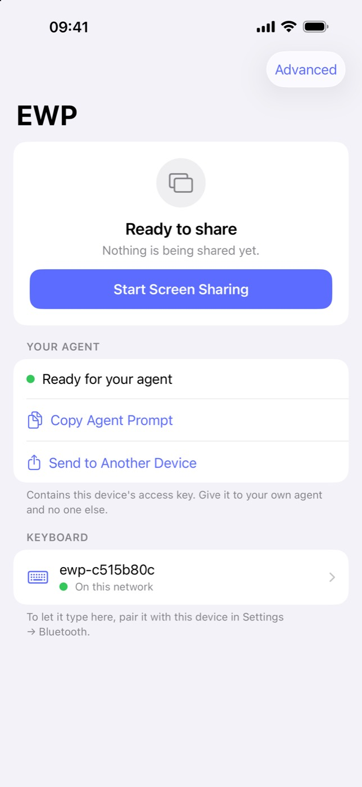 | 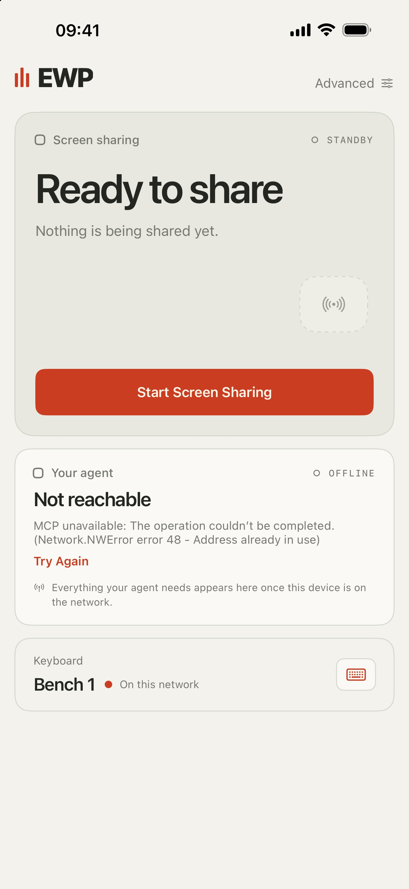 |
| White rounded cards on a grey ground, grey caps section headers, a centred emblem and a tinted blue button. | Warm ceramic ground, a raised standby field with its own beacon, a 44 pt headline and a single vermilion action. iPhone 16 Pro Max simulator. |
| No prior equivalent: the old live state was the same card with a red dot. | 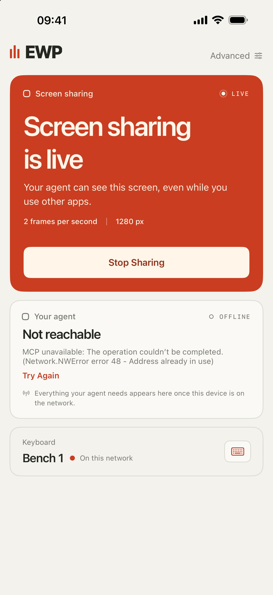 |
| | Live fills the field with vermilion and states what is leaving the device. Captured with the state forced, since a simulator cannot run a broadcast. |
| 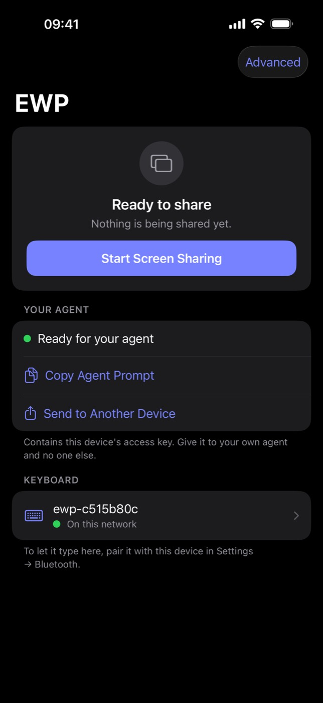 | 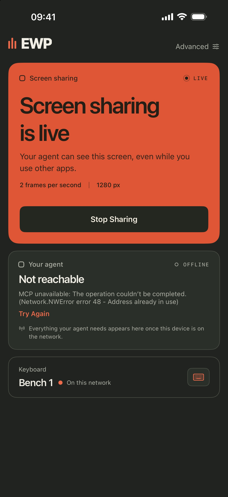 |
| System grouped colours inverted. | A warmer vermilion on graphite ceramic, with the action inverted to ink. |
| 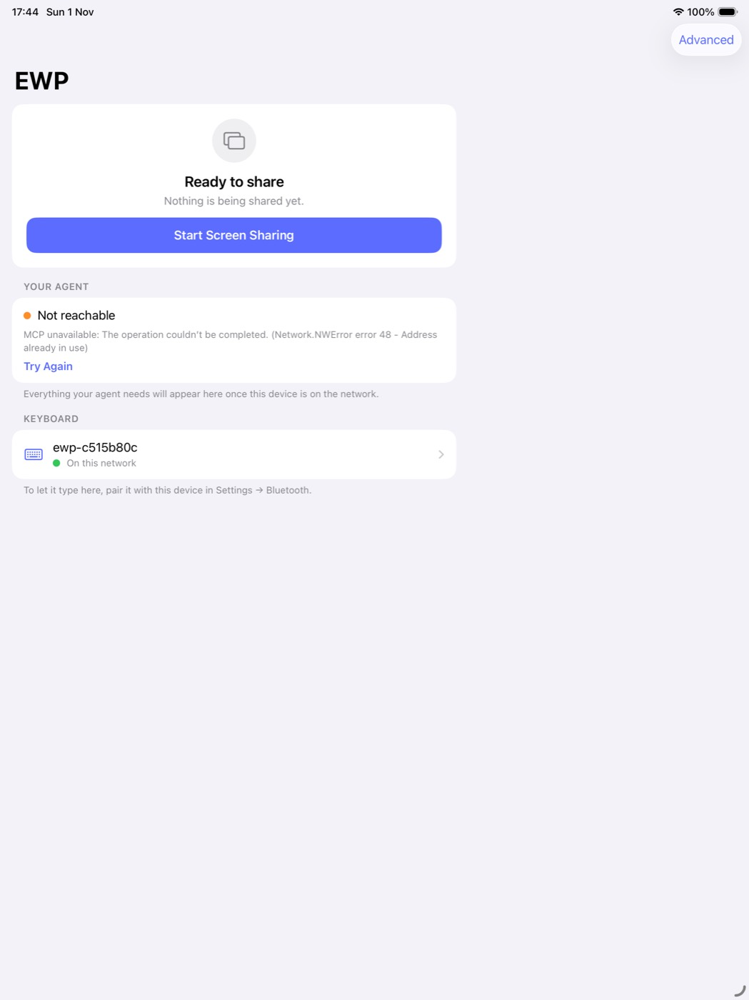 | 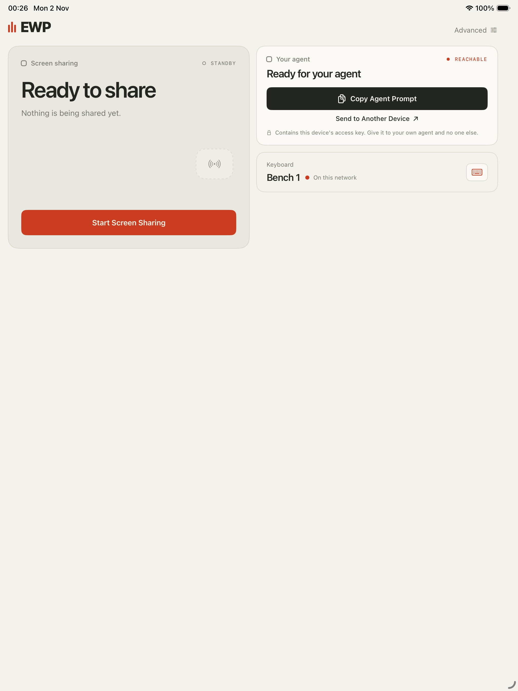 |
| Two columns of grouped cards. | The same two columns in the new language: the field on the left, the two quiet blocks on the right. iPad Air 13 M3 simulator. |

Advanced, the device screens and the keyboard setup sheet follow the same
system and were checked after the change; they kept their structure, so there
is no layout before and after to show for them.

### Verified for this change

| Check | Host / source | Result |
| --- | --- | --- |
| iOS build | Mac, Xcode 27.1, iphonesimulator | Passed, signed with the UnlikeOtherAI team. |
| Home screen, at rest | iPhone 16 Pro Max simulator | Passed in light and dark. |
| Home screen, live | iPhone 16 Pro Max simulator, state forced | Passed in light and dark. The override was reverted before the commit; a simulator cannot run a real broadcast, so the live field has not been seen driven by an actual broadcast. |
| Home screen, iPad | iPad Air 13 M3 simulator | Passed; two columns, content held to a readable measure. |
| Advanced | iPhone 16 Pro Max simulator | Passed; follows the new palette through the shared design system. |
| App icon | `design/make_icon.py`, contact sheet at 1024 to 40 px | Passed; the lit phone still reads at 40 px. |

### Laid out from the space it has, 2 November 2026

The home screen no longer branches on the horizontal size class. It measures
the space it is actually given and decides from that, because the size class
describes none of the cases that matter here: an iPad in a narrow split is a
phone, an iPhone Duo folded shut is a phone and opened out is a short wide
screen, and a phone in landscape has less height than the field alone would
like.

The screen takes one of three shapes:

| Shape | When | What it looks like |
| --- | --- | --- |
| `stacked` | Under 700 pt wide | One column: the field, then the agent block, then the keyboard block. Any phone, and an iPad in a half or third split. |
| `beside` | 700 pt and wider, and wider than it is tall | The two quiet blocks in a column to the right of the field. An unfolded iPhone Duo, an iPad in landscape, a phone in landscape. |
| `below` | 700 pt and wider, and taller than it is wide | The field full width, the two quiet blocks in a row underneath. An iPad in portrait. |

| Rule | Why |
| --- | --- |
| Two columns at 700 pt and wider | An iPhone Duo is 669 pt across its cover screen; splitting that leaves columns narrower than a phone's, which reads worse than one column and a scroll. |
| Headline drops to 78% when a column is under 330 pt | A third-width iPad split is 320 pt, and the headline is the one thing that cannot wrap its way out of it. |
| The field is bounded by its own width, not only by the height left over | The shared screen appears in the field, and a card far taller than it is wide is a void with a button at the bottom. Tying it to the height alone turned a portrait iPad into exactly that. |
| Short content is centred in the space under the wordmark | Anchored to the top it left the bottom half of an iPad blank. The cards keep their own height, so the slack goes to the spacers rather than stretching the field past the size it asked for. |

The field's ceiling per shape: `stacked` 348 pt, with 360 pt left below it for
the header and the other two blocks; `beside` 1.25 × its column; `below`
0.8 × the full width, with 330 pt left for the row underneath. Never under
236 pt.

| Size | Shape | Field | Headline |
| --- | --- | --- | --- |
| iPhone 16 Pro Max portrait, 440 × 956 | stacked | 348 pt | 100% |
| iPhone 16 Pro Max landscape, 956 × 440 | beside | 350 pt | 100% |
| iPhone Duo opened out, 951 × 669 | beside | 565 pt | 100% |
| iPhone Duo folded shut, 466 × 678 | stacked | 318 pt | 100% |
| iPhone 13 mini, 375 × 812 | stacked | 348 pt | 100% |
| iPad Air 13 portrait, 1032 × 1376 | below | 800 pt | 100% |
| iPad Air 13 landscape, 1376 × 1032 | beside | 831 pt | 100% |
| iPad half split, 507 × 1376 | stacked | 348 pt | 100% |
| iPad third split, 320 × 1376 | stacked | 348 pt | 78% |

#### Before and after

| Before | After |
| --- | --- |
| iPad Air 13 portrait: two columns, the bottom half of the display blank. 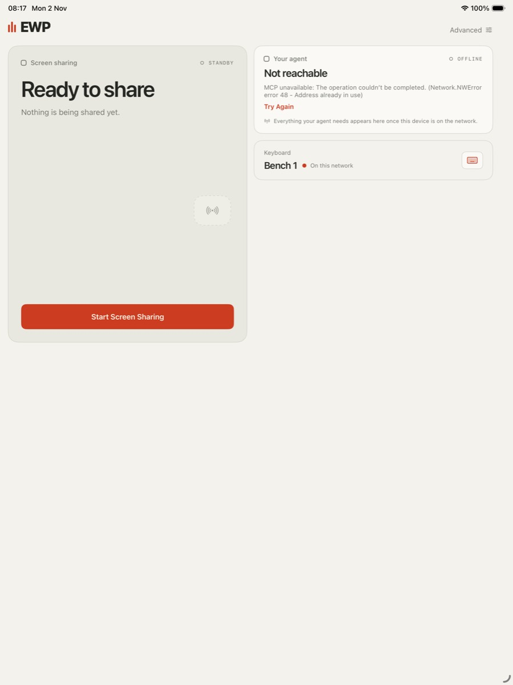 | iPad Air 13 portrait: field full width, the two blocks in a row under it. 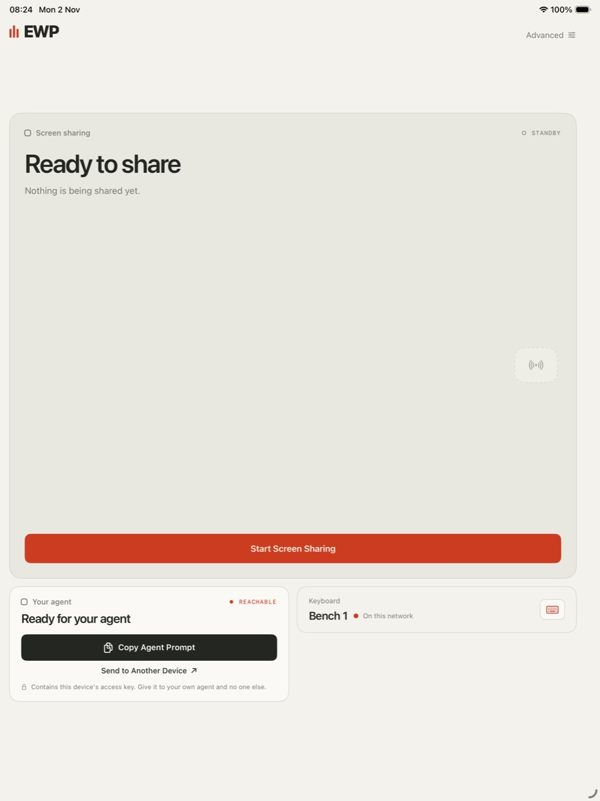 |
| iPhone Duo opened out: field held to 45% of the height, a third of the screen empty below the cards. 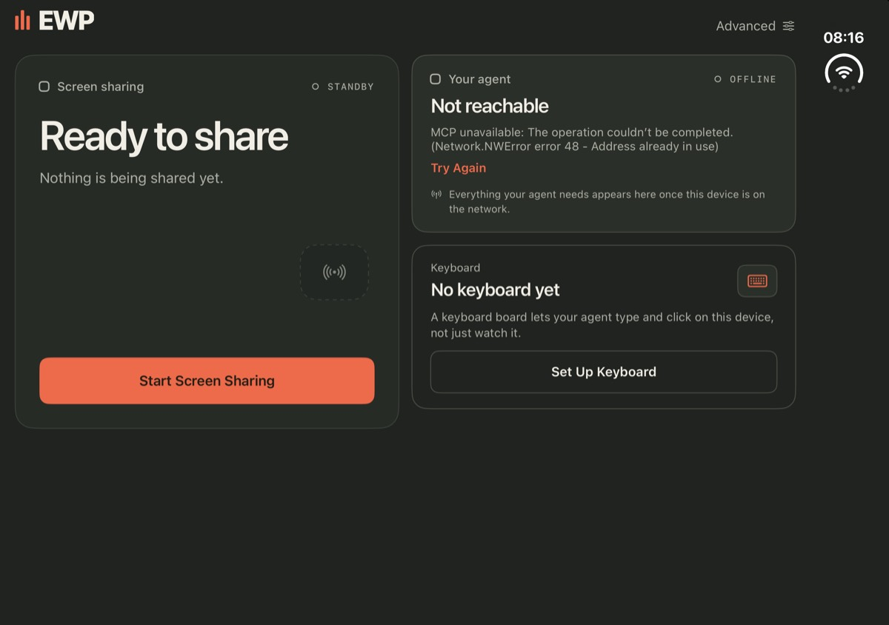 | iPhone Duo opened out: field bounded by its column, cards centred. 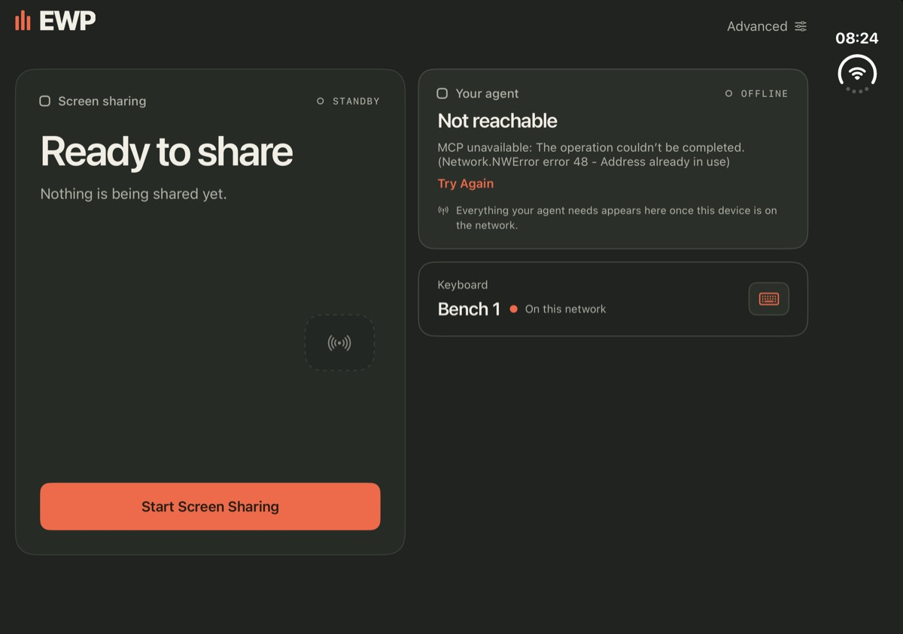 |
| iPhone Duo folded shut: no prior equivalent — the cover screen had never been seen rendered. | iPhone Duo folded shut: one column, scrolls to the keyboard block. 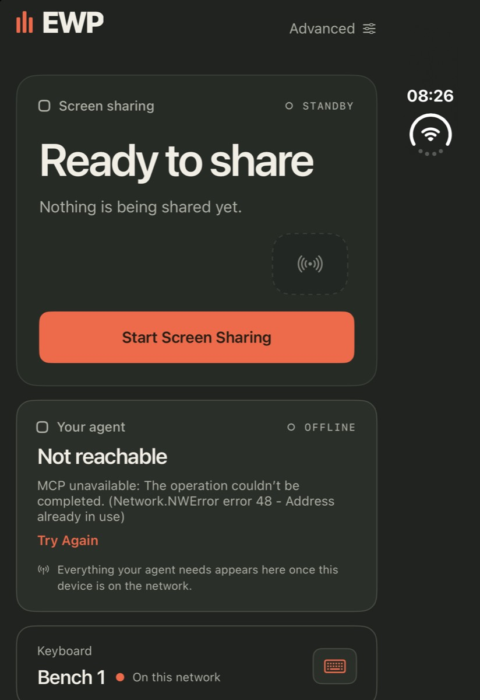 |

#### What the Duo turned out to be

It is a folding phone, and Xcode 27 has no Simulator app — simulators live in
Device Hub, whose device window carries **Closed / Partially Open / Open**
buttons. Closed it presents a 1398 × 2034 px cover screen (466 × 678 pt);
partially open and open it presents a 2853 × 2007 px inner screen
(951 × 669 pt), landscape, not the portrait 669 × 951 that the enumerated
default sizes suggest. Partially open and open give the same geometry. The
screen it is not presenting returns a black framebuffer, which is why earlier
screenshots were black: the device was folded shut the whole time, and the
larger display was simply off.

| Check | Host / source | Result |
| --- | --- | --- |
| iPhone, portrait | iPhone 16 Pro Max simulator | Single column, unchanged. |
| iPhone Duo, folded shut | iPhone Duo simulator, 466 × 678 pt | Single column, scrolls to the keyboard block. |
| iPhone Duo, opened out | iPhone Duo simulator, 951 × 669 pt | Blocks beside the field, cards centred with roughly even margins top and bottom. |
| iPhone Duo, partially open | iPhone Duo simulator | Same geometry as opened out; no separate case. |
| iPad, portrait | iPad Air 13 M3 simulator, 1032 × 1376 pt | Field full width, agent and keyboard blocks in a row underneath. |
| Install on the owner's devices | Physical iPhone 16 Pro Max and iPad Air 13 M3, over USB | Installed on both. |

Not verified: iPad landscape was not reached — the simulator did not take a
headless rotation, so that shape is covered only by the unfolded Duo, which
runs the same `beside` path at a smaller size. The waiting state was not
captured, Dynamic Type above the default was not exercised beyond the
headline's `ScaledMetric`, and no physical device has been seen running this
build. On the simulators the agent block reports `Address already in use`:
they share the Mac's network stack and the MCP server binds a fixed 7801, so
only the first simulator to start gets it. Each real device has its own stack,
and the iPad above shows the block reachable.

## Changed screens

The app page was rebuilt on 1 November 2026. The previous page is the one
shipped earlier the same day and captured below; nothing else on the device
changed appearance. No credentials, pairing PINs or personal Settings screens
are published.

| Before | After |
| --- | --- |
| 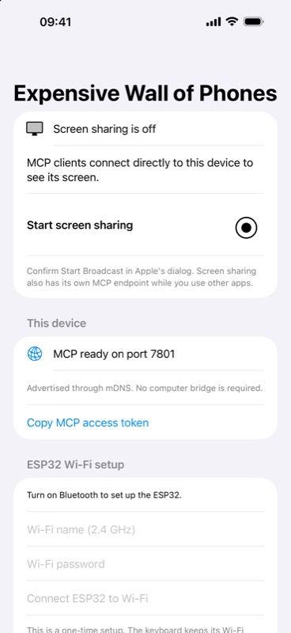 |  |
| Four sections, two always-visible Wi-Fi fields, Apple's unstyled broadcast control, and state as raw strings. Physical iPad / simulator. | Three cards, one action each. iPhone 16 Pro Max simulator, signed build. |
| No prior dark-appearance capture. |  |
| | The accent has its own dark variant in the asset catalogue; cards use elevated system colours rather than an inversion. |
| 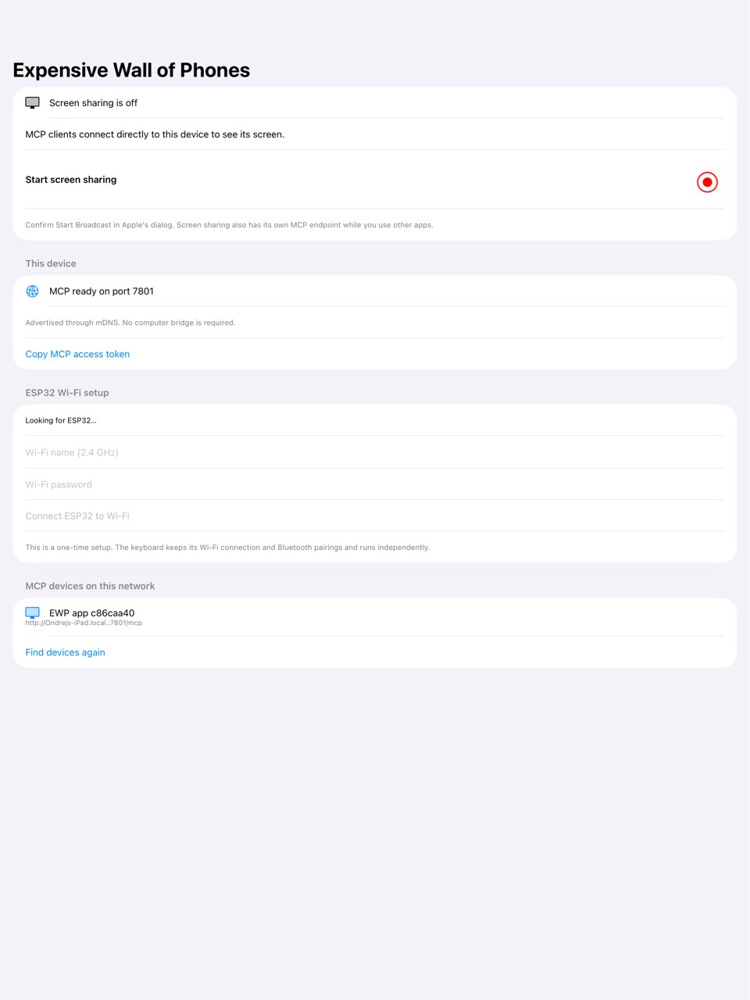 |  |
| Rows stretched the full width of the iPad with the content ending a third of the way down. | Content is held to a readable column aligned with the navigation title. iPad Air 13 M3 simulator. |

The setup sheet and the Advanced screens are new, with no prior equivalent.
The setup sheet was exercised on the simulator, where it correctly reports
missing Bluetooth at step one and leaves the remaining steps pending.

## Verification for this change

| Check | Host / source | Result |
| --- | --- | --- |
| iOS build | Mac, Xcode 27.1, iphonesimulator | Passed, signed with the UnlikeOtherAI team. |
| Rendered app page | iPhone 16 Pro Max and iPad Air 13 M3 simulators | Passed in light and dark appearance. Screenshots above. |
| Screen-sharing request path | iPhone simulator | The button reaches the confirmation state. The broadcast itself cannot run on a simulator, so live capture is unverified here and still rests on the physical iPad evidence above. |
| Keyboard setup sheet | iPhone simulator | Step states render from the provisioning phase. The Bluetooth path itself is unverified on a simulator. |
| ESP32 firmware compilation | Mac, PlatformIO 6.1.18 | Run locally rather than on Maxis, which has no `uv` installed. |
| Tool tests | macOS | Ten tests passed, two skipped as Windows-only. |
| mDNS discovery and the `ewp-discover` CLI | macOS, live network | Four real endpoints found, including a physical ESP32 and iPad. |

## Identity, naming and firmware safety

Added after an architecture review of the 200-device wall. The review is in
[architecture-review.md](architecture-review.md).

### On a physical board, 1 November 2026

Firmware 0.3.0 was built and flashed to the ESP32-D0WDQ6 development board
over USB. The board kept its NVS, so its token, Wi-Fi credentials and setup
code carried over; its id changed from the old 8-hex form to the full 48-bit
`ewp-0cb815c55dc4`, and it rejoined Wi-Fi at the same address. The state it
was replaced from is recorded in the run log; it had no bonds, so nothing
pairable was lost, and 0.2.0 can be restored by building `bf56edb`.

A 29-check acceptance suite was run against that board over its own MCP
endpoint. All 29 passed:

| Area | What was checked |
| --- | --- |
| Protocol | `initialize` names the board and reports 0.3.0; all eleven tools advertised; every description carries the board's name |
| Identity | id carries the full 48-bit MAC; `host_capacity` 8; `store_full` false; Wi-Fi up; `help` states what `notified` does not prove |
| Naming | `set_name` persists and changes the Bluetooth name and every tool description; over-long and non-ASCII names refused |
| Idempotency | a repeated `request_id` replays the first result and does not rename the board a second time |
| Host binding | `press_key` and `move_pointer` refused with no `host_id`, and refused for a host that is not the selected one |
| Bonds | no bonds saved; `forget_host` refuses a wrong `confirm` and an unknown host |
| Identify | runs, advertises as `IDENTIFY <name>`, and bounds its duration |
| Authentication | no token, a wrong token and a browser `Origin` are each rejected with 401 |

Also exercised on that board: `ewp-setup --name` over USB named it and saved
its credentials under the new id; `ewp-fleet status` reported it `ok` and
flagged a device on the network that was not in `wall.json`; `start_pairing`
opened a window, issued a fresh code and advertised under the board's name.

### Two faults found by running it, and fixed

- **Renaming a board took it off the network.** `set_name` ended the mDNS
  responder and let the loop restart it; on ESP32 that leaves the service
  advertised but unresolvable, so the board kept answering on its IP while
  disappearing from discovery until a power cycle. Setting the TXT item again
  in place fixes it. Verified by renaming the board and finding it still
  listed, under its new name, without a reboot.
- **`ewp-fleet` refused names the board accepts.** The board takes any
  printable ASCII name, so "Row 4 Seat 2" is legal, but the tool required a
  name that was already a valid MCP server key and rejected it. The key is now
  derived from the name instead.

## Device identity

Added 1 November 2026, after a question about how a device stays the same
device across a rename.

Each device owns a stable identifier and publishes it as the `id` key in its
mDNS TXT record. Everything that refers to a device — the app's list, saved
access tokens, `wall.json`, the `ewp-fleet` reports — is keyed by that
identifier and never by a name or an address.

| Device | Identifier | Survives |
| --- | --- | --- |
| ESP32 board | its 48-bit MAC, as `ewp-0cb815c55dc4` | a reflash, an NVS erase, a rename, a new network. It cannot collide, and the board needs no stored identifier at all. |
| iPhone or iPad | a random UUID made on first launch and kept in the keychain | relaunching, renaming, rebooting, changing network, updating the app. It resets when the app is deleted and reinstalled. |

The iOS identifier is deliberately not synchronised through iCloud. Syncing it
would hand the same identity to every device restored from one backup, which on
a wall of 200 phones is a worse failure than a device coming back as new. The
price is that reinstalling the app produces a new identifier, which is why
saved devices that are not on the network stay listed and removable.

The mDNS instance name is built from the identifier (`EWP app 36c520d9`), not
from the human name, so renaming a device never creates a second entry
anywhere. The name travels in the TXT record beside the identifier.

### On a physical board and two app instances, 1 November 2026

| Check | How | Result |
| --- | --- | --- |
| The board's identifier is its MAC | `esptool chip_id` over USB against the advertised id | `0c:b8:15:c5:5d:c4` matches `ewp-0cb815c55dc4` |
| A device that leaves and returns is still one device | hard-reset the board, watch discovery | gone while it rebooted, then back under the same id and the same name, one entry, no duplicate |
| A name survives losing power | the same reset | NVS kept `Bench 1` |
| An iOS identifier resets with the app's keychain | deleted the app's two keychain rows, relaunched | new identifier and a new token; the old identity never returns |
| Adopting another device proves the token first | connected to a mock endpoint from the app | the app called `help` before saving, and the key marker appeared in the list |
| A device the tools have under an old identifier | `ewp-fleet status` | reports the pairing by name and says which identifier to put in `wall.json`, instead of blaming the network |
| A saved device that stops answering | stopped a throwaway endpoint with the list open | left the live list and appeared once under "Saved, Not Answering" in about ten seconds, with its last known name and its identifier |
| The same device answering again | started it again | returned to the live list with its key marker, and the saved section disappeared |
| Removing a stale entry | tapped Remove | the keychain item went, and the device fell back to being an ordinary discovered device |

### A third fault found by running it, and fixed

**The app kept listing a device that was gone.** Bonjour keeps a service
record for as long as its time to live, and a device that dies without sending
a goodbye leaves one behind; restarting the browser only reads the same cache,
so "Find Devices Again" brought the dead device straight back. The Mac's own
browser, which starts with an empty cache, had already dropped it. A saved
device is now counted as present only when it answers: one saved device is
asked per two-second tick, in turn, so a wall of them is never swept at once.
A device that stops answering moves to "Saved, Not Answering" within about ten
seconds and moves back as soon as it answers again, and it is never in both
lists at once.

Testing that also showed the list was frozen while anyone looked at it: the
home screen's loop stops when a screen is pushed over it, so the Network screen
now runs its own while it is on screen.

Both were verified by adopting a throwaway endpoint, stopping it, starting it
and stopping it again, with the list open throughout, and then removing it.

`~/.config/ewp` on this Mac still holds credentials for the board under both
its old 8-hex identifier and its current 48-bit one: one device, two sets of
files, left behind when the identifier format changed. That is the duplicate
this work is about, and `ewp-fleet status` now names it.

### Not verified

**No Bluetooth pairing or input was proved.** The chain from `start_pairing`
through a bonded host to a keystroke landing on a screen is still unverified,
exactly as it was before this round. Reaching it needs a target device to pair
with, and none was available: both physical iOS devices were locked, which
this product does not and should not work around, and permission to drive this
Mac's Bluetooth settings was declined. The board's side — opening the window,
issuing a per-window code, advertising under its name — is confirmed; what
happens after a host accepts the code is not.

The earlier Bluetooth failure (`authentication_state: -1`, disconnect reason
520) was reproduced on the old firmware before flashing, and its cause is
understood: the board displays a passkey that only reaches a serial console,
so a person pairing from a phone has no way to read it. `start_pairing`
returns the code over MCP, so an agent-driven pairing has one; a person using
the app's Bluetooth setup flow still does not. The review's P3 covers that
handoff and it is not implemented.

Also unverified: mDNS recovery after a Wi-Fi drop uses the same end-and-begin
pattern that was just fixed for renames, and was not exercised. `identify`
has no LED on this board. Nothing has been tested with more than one board.

### What the Bluetooth chain does and does not do, 2 November 2026

The board was reached over USB serial and over BLE from the Mac. Everything up
to the bond is verified; nothing past it is, and the reason is structural
rather than a bug.

| Check | How | Result |
| --- | --- | --- |
| Board is alive | USB serial `status` on `/dev/cu.usbserial-0001` | `ewp-0cb815c55dc4`, named `Bench 1`, firmware 0.3.0, 8 bond slots, none used. |
| Bonds ever made | Same | `saved_hosts: 0`. No host has ever paired with this board. |
| Advertising | 25 s CoreBluetooth scan with duplicates, from a signed app bundle | 81 packets. Appearance `0x03C1` (keyboard), services `0x1812` (HID over GATT) and the EWP service. |
| Advertised name | Same | 79 of 81 packets carried `LocalName` `EWP Bench 1`, which is what `start_pairing` would tell a person to look for. |
| One board, not two | Held the USB board in reset over DTR/RTS and rescanned | The advertisement disappeared, so the single advertiser is this board. |
| GATT | Connected without requesting a bond and enumerated | Device Information, Battery, and the EWP service with its write and notify characteristics. |

Two things that look like faults and are not. The advertising packet itself
carries no name: flags, the 128-bit EWP service, `0x1812` and the appearance
come to 29 of its 31 bytes, so the name rides in the scan response, which is
where an active scanner reads it. And `0x1812` does not appear in the GATT
enumeration above because macOS reserves HID for its own stack and hides it
from third-party apps, so that enumeration is no evidence either way.

One thing that is worth knowing. macOS reports this board's cached name as
`ewp-c515b80c`, an identifier from an earlier firmware, and that stale cache
is why `~/.config/ewp` holds credential files under two identifiers for what
is one board.

#### Why the rest cannot run yet

`press_key` is an MCP call, so it needs the board's HTTP endpoint, so it needs
Wi-Fi. Wi-Fi is provisioned over the BLE characteristic, and the firmware
refuses that write unless the link `isAuthenticated()` and `isEncrypted()`:

    if (!info.isAuthenticated() || !info.isEncrypted() || !setupOpen()) return;

So the bond comes first and everything else follows it. With no bond there is
no Wi-Fi, with no Wi-Fi there is no MCP endpoint, and `start_pairing`,
`select_host` and `press_key` cannot be called at all. The board is not on
Wi-Fi now: `wifi_connected: false`, no address.

Bonding needs a person, by design. The board sets
`setSecurityIOCap(BLE_HS_IO_DISPLAY_ONLY)` with bonding, MITM and Secure
Connections, so the host asks for a passkey the board is supposed to be
displaying. It has no display, so the code reaches a person only through the
serial console or a printed label. Connecting from the Mac during this check
raised exactly that prompt.

#### A keyboard that asks for a passcode is the wrong way round

Ordinary Bluetooth keyboards either pair Just Works or have the host show
digits that are typed on the keyboard. This board can do neither: it has no
screen to show a code and no keys to type one on. The consequence is a label
per board, and on a wall of two hundred that is two hundred labels and no
phone-only setup, which is the same dead end recorded above as P3.

`BLE_HS_IO_NO_INPUT_OUTPUT` without MITM would pair the way a keyboard
actually does, inside the 180 s window that `start_pairing` already opens. It
is not a free change: `isAuthenticated()` is false for a Just Works bond, so
the Wi-Fi provisioning gate quoted above would have to drop to `isEncrypted()`
and lean on that window instead. That trades MITM protection during pairing
for setup that works from a phone. It is an owner's decision, not a defect,
and it is not made here.

Counters such as `connections_seen` cannot be read after the fact over the
same cable: opening the serial port resets the ESP32, so every reading of them
in this check was taken from a board that had just rebooted.

### Pairing the way a keyboard pairs, 2 November 2026

The board no longer asks a host for a passkey. `BLE_HS_IO_DISPLAY_ONLY` with
MITM meant the host prompted for a code the board was supposed to be showing,
and it has no screen, so the code reached a person only over USB or on a
printed label: two hundred labels for a wall, and no setup from a phone.

| Change | Before | After |
| --- | --- | --- |
| IO capability | `BLE_HS_IO_DISPLAY_ONLY`, MITM on | `BLE_HS_IO_NO_INPUT_OUTPUT`, MITM off, bonding and Secure Connections kept |
| `onAuthenticationComplete` | Disconnected any link that was not `isAuthenticated()` | Requires `isEncrypted()` only |
| Wi-Fi provisioning write | `isAuthenticated() && isEncrypted() && setupOpen()` | `isEncrypted() && setupOpen()` |
| Pairing window | 5 minutes after boot, only with zero bonds | Always open while there are zero bonds; otherwise a 180 s `start_pairing` window |
| Provisioning window | 5 minutes after boot | Open while Wi-Fi is not connected |
| `start_pairing` result | Returned a fresh `pairing_code` | No code; the response says so and the tool text matches |
| Serial `access` | `pairing_code` | `setup_code`, kept in NVS for the encrypted provisioning scheme that is not built yet, and no longer printed at boot |

A Just Works bond is encrypted but never authenticated, so the two
`isAuthenticated()` gates would have dropped every bond the instant it
completed. Timing matters as much: `start_pairing` is an MCP call, MCP needs
Wi-Fi, and Wi-Fi arrives over a bonded link, so a board with nothing paired
could never have its window opened by any means except a power cycle.

| Check | How | Result |
| --- | --- | --- |
| Flash backed up first | `esptool read-flash 0 0x400000` | 4194304 bytes saved before anything was written. |
| Builds | `pio run` | Succeeds. Flash 86.8% of 1310720 bytes, RAM 18.2%. |
| Flashes and comes back | `pio run -t upload`, then serial `status` | `ewp-0cb815c55dc4`, still named `Bench 1`, token and NVS intact, `pairing_open: true`. |
| No passkey prompt | Connected from the Mac over BLE | The macOS passkey dialog that this same connection raised before the change did not appear. |
| Board still asks to pair | Serial `status` read live, without resetting the board | `connections_seen` 0 to 1 and `security_request_result: 0`, so `startSecurity()` was called and returned success. |

Not verified: no bond has been completed, so nothing past it has been either.
`authentication_state` stayed 0 and `saved_hosts` stayed 0 on that attempt.
This Mac is the wrong host to judge it on, because it still holds a stale bond
for this board's address under the old identifier `ewp-c515b80c` while the
board's own store is empty, and a host with keys the device has forgotten
gives up rather than re-pairing. The clean test is a phone that has never seen
this board.

Reading these counters needs care: opening the serial port normally resets the
ESP32 and zeroes them, so the readings above were taken over a connection
opened with DTR and RTS held low.

### The chain, as far as a keystroke, 2 November 2026

Everything up to the keystroke now runs. The board pairs with no code, takes
Wi-Fi, serves MCP, and answers tool calls. What has not happened is a key
press, and the reason sits on the host.

| Step | How | Result |
| --- | --- | --- |
| Bond, no code | Connected from the Mac over BLE | `saved_hosts` 0 to 1, `authentication_state: 1`, no disconnect. No passkey prompt. |
| macOS accepts it as a keyboard | `system_profiler SPBluetoothDataType` | Listed as `EWP Bench 1`, Minor Type Keyboard, battery 100%. |
| Wi-Fi over the cable | `ewp-setup --port … --wifi-file …` | Joined and held: `wifi_connected: true`, `192.168.1.193`. |
| Discoverable | `ewp-discover` | `Bench 1  keyboard  http://ewp-0cb815c55dc4.local:80/mcp`. Port 80, not 7801. |
| MCP over Wi-Fi | `tools/call list_hosts` with the saved token | One host, `d0:11:e5:cd:33:38/0`, the Mac's own controller address. |
| `select_host` | `tools/call` | Accepted: `selected_host` set, `state: waiting_for_selected_host`. |
| Mac reconnects | Polled `device_status` for 40 s | `ble_connections: 1` and `authentication_state: 1`, so it is connected and encrypted. |
| `hid_connected` | Same | Never true. The board does not take the Mac as its HID host, so `press_key` is refused. |

`last_disconnect_reason: 534` is `BLE_HS_ERR_HCI_BASE + 0x16`, terminated by
the local host: that is `select_host` dropping the peer on purpose, not a
fault.

Two candidate causes, not yet told apart:

1. macOS says so itself. Its Keyboard Setup Assistant reports that the device
   "cannot be identified and will not be usable until it is identified", and
   the board sets `hid->setHidInfo(0, 1)` — a HID country code of 0, meaning
   not supported. A host that will not use the keyboard has no reason to
   subscribe to its input reports.
2. `acceptSubscribedHost` learns about subscriptions only from `onSubscribe`.
   NimBLE 2.3.6 exposes no way to ask whether a connection is subscribed, so if
   a bonded peer's CCCDs are restored from the store without firing that
   callback, the board can never know, and a reconnecting host can never
   become the HID host however long it waits.

The first is testable by giving the board a real country code or by dismissing
the assistant; if a subscription still never arrives, the second is the
problem, and it is the more serious of the two because it would affect every
reconnection rather than only the first.

Not verified: no key has been pressed on any host. `press_key`, `move_pointer`
and the `notified` reporting remain untested, as does typing into a phone,
which is the product's actual purpose and whose host stack may not demand
layout identification the way macOS does.

### Telling a host what layout these keys are in, 2 November 2026

`hid->setHidInfo(0, 1)` declared the HID country code as 0, "not supported".
That is why macOS opened its Keyboard Setup Assistant — "Your UnlikeOtherAI
device cannot be identified and will not be usable until it is identified" —
and then asked a keyboard with no keys to press the one beside its left Shift.

The code is now stored in NVS under `layout`, defaulting to 13, International
(ISO), which is the safest answer for a board with no opinion and is in any
case better than 0. It is settable three ways: the `set_layout` MCP tool, by
short name (`cz`, `uk`, `us`) or by number; the layout picker on the app's
keyboard setup screen; and whatever was stored last, at boot.

| Where | What it does |
| --- | --- |
| `firmware/src/main.cpp` | `keyboardLayouts` maps short names to the USB HID 1.11 section 6.2.1 codes. `persistLayout` stores the code, calls `setHidInfo` and signals Service Changed. `device_status` reports `keyboard_layout` and `keyboard_layout_code`; `help` carries the whole table under `layouts`. |
| `ios/EWP/HIDKeyboardLayout.swift` | The same table for the app, plus the region map and `forRegion`, which falls back to International rather than guessing. |
| `ios/EWP/KeyboardSetupView.swift` | Step 5 of setup: a picker, showing the region's layout until the board answers for itself. |
| `ios/EWPTests/` | A new unit-test target. The region map is the only part that guesses, so it is the part pinned down. |

#### What the country code is not

It tells a host which physical layout to assume. It does not decide what a key
types. `press_key` sends a HID usage, and the character that arrives is
whatever that usage means under the layout the **host** is set to: usage 4 is
`a` on a US host and `q` on a French one, whatever this board declares.

So typing arbitrary text still needs a character-to-usage map per layout, and
nothing in this repository has one. An agent that wants to type `ý` cannot ask
for it; it can only send usages and hope the host agrees. The picker does not
solve that and is not meant to. `help` says so in as many words, so an agent
reading the tool list is not left to infer it.

#### Changing it on a host that is already paired

`setHidInfo` only writes the characteristic value, so nothing is rebuilt and
the board does not reboot: the next host to discover the service reads the new
value. A host that discovered it earlier cached the old one. `persistLayout`
calls `ble_svc_gatt_changed(0x0001, 0xffff)` to ask it to look again, which
bonded hosts honour if they subscribed to Service Changed, at the cost of
re-discovering every service and interrupting input while they do. A host that
does not honour it keeps the old layout until it pairs again. The tool
description says this; so does the tool's own reply.

| Check | How | Result |
| --- | --- | --- |
| Firmware builds | `pio run` | Succeeds. Flash 87.0% of 1310720 bytes. |
| App builds | `xcodebuild` for the iPhone simulator | Succeeds. |
| Region map | `xcodebuild test -only-testing:EWPTests` | 7 tests, 0 failures. Covers the regions that do not match their language (Austria German, Ireland British, Australia and India US), case folding, and the fallback for unmapped, empty and nil regions. |

#### On the board

Flashed to `ewp-0cb815c55dc4` and driven over its MCP endpoint rather than the
cable, because opening the serial port resets the ESP32 and would have ended
each observation before it started.

| Check | Result |
| --- | --- |
| Default on a board with nothing stored | `keyboard_layout: iso`, `keyboard_layout_code: 13`. |
| `set_layout` by name | `{"layout": "cz"}` returned code 5 and `device_status` agreed. |
| Persistence across a reboot | After reflashing, which reboots the board, `keyboard_layout: cz`, code 5. Read from NVS, not a default. |
| The bond survives a flash | `saved_hosts: 1` and `selected_host` unchanged throughout. |

#### Whether the country code was what macOS was objecting to

It was, on this evidence, though the two changes were not isolated from each
other and the honest reading is below.

With the code at 0, across two boots, the Mac bonded and encrypted
(`authentication_state: 1`) and stayed connected, and `subscribe_events`
remained **0** while `accept_rejections` reached 4. The host never wrote a
CCCD at all. That rules out the board losing track of a subscription it had
been told about: there was nothing to lose. NimBLE forwards restored
subscriptions through the same `onSubscribe` path as new ones
(`NimBLEServer.cpp`, `BLE_GAP_EVENT_SUBSCRIBE`), so a silently restored CCCD
would still have been counted.

After the code became non-zero and `persistLayout` signalled Service Changed,
the next reconnect gave `subscribe_events: 2`, `persisted_subscriptions: 5`,
and **`hid_connected: true`** for host `d0:11:e5:cd:33:38/0` — the first time
this board has ever had a subscribed host.

What stops this being a clean single-variable result: the subscription did not
appear the moment the code changed. It appeared on the reconnect after that,
so the reboot and the cache invalidation are tangled with the code change. A
host that has already discovered a board caches its HID Information, and macOS
appears to act on Service Changed by invalidating rather than re-reading
immediately. The sequence that works is: set a non-zero code, signal Service
Changed, let the host reconnect.

#### A key, pressed, arriving

With `hid_connected` true and an empty TextEdit document in front on the
bonded Mac, four `press_key` calls over MCP — usages 8, 26, 19, 28 — put
**`ewpy`** in the document.

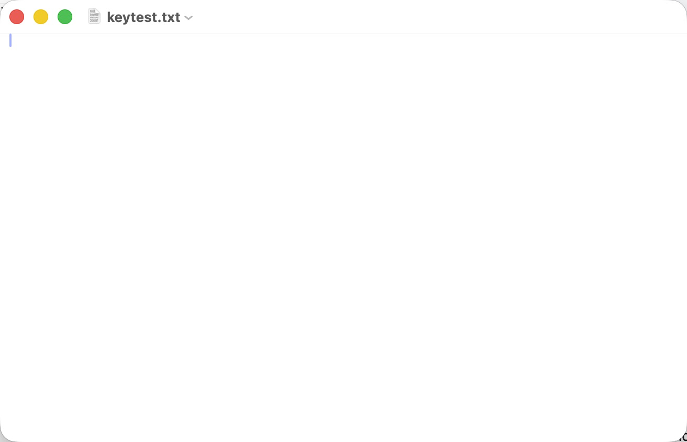

That is the whole chain working for the first time: an MCP call to the board
over Wi-Fi, a HID report over Bluetooth, and a character in an application on
the host. `notified: true` on each call, and now a host action to go with it.

The fourth character is the useful one. Usage 28 is `y` on a US layout and `z`
on a Czech QWERTZ one. The board was declaring Czech, country code 5, and `y`
arrived — because the declaration tells the host what the keys *are*, while
the character is chosen by the layout the host is *set to*, which here is US.
This is the limit described above, demonstrated rather than asserted: an agent
that needs a particular character still cannot get it by sending a usage and
hoping.

The picker has also not been seen rendered, because the step only appears once
a board is on Wi-Fi and reachable over MCP, and because reaching it needs this
device to hold the board's token.

One limit of the app path worth naming: the picker calls `set_layout` over the
board's MCP endpoint, so it needs the board on Wi-Fi *and* this device holding
its access token, which today is only obtainable over USB. On a phone that has
never been given that token the picker reports it and does nothing else. The
BLE provisioning characteristic would be the natural channel for a phone-only
setup, and it was deliberately left alone here.

### A keystroke, end to end, 2 November 2026

The chain runs. An MCP tool call reaches the board over Wi-Fi, the board sends
a HID report over Bluetooth, and the characters appear on the host.

The target was chosen on purpose rather than taken as found: an empty document
opened in TextEdit, confirmed frontmost before anything was sent, because a
keystroke goes wherever focus is and the only bonded host was the owner's own
machine.

| Check | Sent | Read back |
| --- | --- | --- |
| Three keys | `press_key` usages 8, 26, 19 | `ewp` in the document, read with AppleScript, not from a screenshot. |
| A modifier | `press_key` usage 26, modifiers 2 | `ewpW`. Shift reached the host. |
| The pointer | `move_pointer` dx 80, dy 60 | Cursor moved from 1702,1083 to 1829,1295. Right direction; the larger distance is macOS pointer acceleration. |

Usages 8, 26 and 19 were picked to avoid y and z, which swap on a Czech
QWERTZ layout. That caution turned out to be misplaced, and the reason is
worth recording: a sibling session sent usage 28 while the board was declaring
Czech (country code 5) and the host produced `y`, not `z`. The country code
tells the host what the physical keyboard is; the character a usage produces
is decided by the host's own active layout, which was US. So typing specific
text still needs a character-to-usage map per host layout. That is now
observed, not argued.

Every call returned `notified: true` with `host_action_verified: false`, which
is the firmware being honest: it knows it sent the report and does not claim
the host acted on it. The reading back above is what closes that gap.

#### Two bugs this found, in order

The first keeps a host from ever subscribing. `setHidInfo(0, 1)` gave a HID
country code of 0, "not supported", and macOS answered with its Keyboard Setup
Assistant: "cannot be identified and will not be usable until it is
identified". It then bonded, encrypted, read the service and subscribed to
nothing. `subscribe_events: 0`, `accept_rejections: 4`.

The second keeps it from coming back. After a reboot, with the host bonded and
encrypted and five CCCDs in the board's store, no subscription ever reached
`acceptSubscribedHost`, so the host stayed connected, encrypted and unusable
for as long as it was left: `persisted_subscriptions: 5`,
`subscribe_events: 0`, `authentication_state: 1`, `hid_connected: false`.

The mechanism is not what the fix's commit message (11b03e1) says. It claims
NimBLE restores stored CCCDs without firing `onSubscribe`. That is wrong:
`ble_gatts_subscribe_event` is called with `BLE_GAP_SUBSCRIBE_REASON_RESTORE`
and `NimBLEServer` does forward it to `onSubscribe`, so a silent restore would
still have been counted. The counter stayed at 0 through an encrypted
reconnect with five CCCDs in the store, which means **the restore did not
happen at all**. Why it did not is not established here.

The fix stands either way, because it does not depend on the reason: a bonded,
encrypted peer is accepted without waiting for a callback that did not come,
and `notify()` still reports whether the report actually went out.

This is the more dangerous of the two for a wall. The first bites once, at
setup, where someone is watching. The second bites every morning, and looks
exactly like a board that has died.

#### Flashing leaves this board dead

`pio run -t upload` reports success and a hard reset, and the board does not
come up: no ping, no MCP, no BLE. Opening the serial port again reboots it
properly, which is how it was recovered every time. esptool's closing reset
leaves it in the ROM bootloader, and `rst:0x1 (POWERON_RESET)` with no crash
backtrace is what that looks like from the console.

This cost two test runs and sent the work chasing firmware faults that were
not there. One of them was a pairing attempt from the owner's phone, which
reported a dialog appearing and vanishing: the board was not on the network at
all at the time, so that attempt proved nothing. Any flash should be followed
by opening the port once, and any board that goes quiet right after a flash
should be suspected of this before its firmware is.

Still not verified: nothing has been typed into a phone or tablet, which is
the product's purpose. iOS has never completed a bond with this board, so the
whole iOS path — pairing, provisioning from the app, and typing into it —
remains untested. `host_action_verified` is always false and no tool confirms
what the target did; the reading back above was done by hand.

### Driving the app from outside, 2 November 2026

The owner's point: if an agent cannot set this up without someone tapping, then
anyone using it without the source has the same wall. Driving the iOS app over
its own MCP endpoint found four things in the way of that.

| Fault | What it looked like | Fixed |
| --- | --- | --- |
| `discover_devices` clears what it returns | `rescan()` does `nearby.removeAll()` before restarting the scan, so an agent polling the discovery tool empties the list on every call and never sees a keyboard. `get_status`, which does not rescan, showed it immediately. | No. Worked around by scanning once and reading `get_status`. |
| No way to tell a fruitless scan from no scan | `bluetooth` reported "Looking for a keyboard…" whether or not the radio was scanning, and `rescan()` returned silently when the central was not powered on. | Yes. `bluetooth_state` and `bluetooth_scanning` are served, and `rescan()` now sets the denied or off phase instead of returning in silence. |
| No Bluetooth in the background | There were no `UIBackgroundModes` at all, so iOS delivers no discoveries once the app is not frontmost. | Yes. `bluetooth-central`. |
| The screen sleeping takes the device off the network | Locking suspends the app, which ends the MCP endpoint and the scan. | Partly. The idle timer is disabled while the app runs, which stops a device that is awake from falling asleep. It cannot wake a device that is already locked. |

One more in the firmware, the same fault as before in the one place it was
missed: `onConnect` called `NimBLEDevice::isBonded()`, which reads the bond
store, on the BLE host task. The phone connected repeatedly — `connections_seen`
10 to 15 — and every link died with `last_disconnect_reason: 520`, HCI 0x08,
supervision timeout. loop() now samples the bonded identity addresses beside
the bond count and `onConnect` reads the sample.

#### What stops an agent setting this up alone

Two things, and only the second is fixable in code.

The access key. An agent has no way to obtain a device's MCP token by itself.
The board has the USB cable as its trust anchor; the phone has nothing
equivalent, so the key has to be carried across by a person through "Copy Agent
Prompt" or the share sheet. The owner's proposal is the right shape: an agent
asks the device for access, the device shows an approval prompt, and one tap
grants it for good. That is not built.

The app has to be frontmost. With the phone locked, the app's process stays
resident — PID 63981 was alive throughout — but iOS freezes it, and the MCP
endpoint refuses connections. Relaunching over USB with `devicectl` starts it
but cannot unlock the device. So a wall device has to be unlocked with EWP in
front, and that is now a requirement of the design rather than an accident.

Still not verified: the phone has never completed a bond. It finds the board
(`EWP Bench 1`, `7FFF2716-C51B-265A-75EA-3851606FD310`) and connects, and
nothing has yet been typed into any phone or tablet.

### Special keys and modifiers, 2 November 2026

Everything asked for is already within `press_key`'s existing schema. Sent to
the bonded Mac, read back from a TextEdit document with AppleScript:

| Key | Sent | Document after |
| --- | --- | --- |
| `a` | usage 4 | `a` |
| Tab | usage 43 | `a\t` |
| `b` | usage 5 | `a\tb` |
| Option+s | usage 22, modifiers 4 | `a\tbß` |
| Escape | usage 41 | unchanged, which is correct here |
| Right arrow | usage 79 | unchanged, cursor moved |
| `c` | usage 6 | `a\tbßc` |

The `ß` is the proof that a modifier other than Shift reaches the host, and
Ctrl travels the same bitmask: 1 left Ctrl, 2 left Shift, 4 left Alt, 8 left
GUI, and 16/32/64/128 for the right-hand set. The `c` arriving at the end
confirms the arrow moved the caret rather than doing nothing. Arrows are 79 to
82, Home/End/Page Up/Page Down 74 to 78.

What is genuinely out of reach: a bare modifier press, because `usage` is
required and bounded at 4 to 101, so Ctrl or Cmd on its own cannot be
expressed; and anything above 101, which is F13 upward and the media and
volume keys. F1 to F12 are 58 to 69 and fit.

#### A host that parks itself and never recovers

A peer can connect with a private address that resolves to its identity only
after `onAuthenticationComplete` and `onSubscribe` have both run. Both are
one-shot, so `permittedHost()` is false while they fire, `parkedPeer()` returns
in silence, and the selected host stays parked for good: encrypted, subscribed,
and refused. Measured: `subscribe_events: 2`, `accept_rejections: 0` because
the silent return is not a rejection, `authentication_state: 1`,
`hid_connected: false` for as long as it was left.

`loop()` now re-offers every encrypted peer while nothing holds input. The
board recovers by itself instead of waiting for a reconnection that nobody is
there to trigger, which on a wall is the difference between a device that comes
back and one that looks dead.

### A fresh host bonds, with no code and nobody watching, 2 November 2026

A second ESP32 now plays the part of a phone. `firmware/test-central` is a BLE
central that finds the keyboard, connects, lets it drive security, and reports
what happened as JSON over USB. `firmware/test-central/rig.py` drives both
boards and needs no person at all.

    1. clearing the rig's bonds : bonds cleared
    2. window on the keyboard  : pairing_open true, 180 s
    3. rig scan                : scanning
    4. rig found after 3 s     : found EWP Bench 1
    5. rig connects            : bonded, encrypted true, bonded_peers 1
    7. keyboard after          : saved_hosts 1 to 2
    8. hosts                   : dictator Mac, and test rig 0c:b8:15:c3:6e:1a/0

So the keyboard's pairing path works for a host it has never seen: no passkey,
no dialog, no tap. That had never been shown before — the Mac's bond predated
most of the day's changes, and every iPhone attempt had failed.

It took three disconnects to get there, all found from one observation that a
pairing dialog appeared on the iPhone and vanished in under a second. Half a
second is far too fast for the supervision timeouts that had been the visible
symptom, which is what pointed at the board dropping the link on purpose.

What this does not prove: nothing has been typed into a phone or tablet, and no
iOS device has completed a bond. An ESP32 central is not an iOS host; it cannot
reproduce iOS's own pairing behaviour, and it is not a HID target. It proves
the board is not the one refusing.

The board the rig runs on had unrelated ESP-IDF firmware on it, in softAP mode,
MAC `0c:b8:15:c3:6e:18`. Its whole 4 MB flash was read off before anything was
written, 4194304 bytes, SHA-256 beginning `52624ed6`, so it can be put back.

### The whole chain, byte for byte, with no phone, 2 November 2026

The rig now subscribes to the keyboard's HID input reports and prints each one
as it arrives, so a keystroke can be checked against the bytes that reached the
host rather than against a `notified` flag.

| Sent over MCP | Expected | Received by the rig |
| --- | --- | --- |
| `press_key` usage 4 | usage 4, no modifier | `00 00 04 00 00 00 00 00` |
| `press_key` usage 43 | Tab | `00 00 2b 00 00 00 00 00` |
| `press_key` usage 5, modifiers 2 | Shift+b | `02 00 05 00 00 00 00 00` |
| `press_key` usage 76, modifiers 5 | Ctrl+Alt+Delete | `05 00 4c 00 00 00 00 00` |
| `press_key` usage 62 | F5 | `00 00 3e 00 00 00 00 00` |
| `press_key` usage 79 | Right arrow | `00 00 4f 00 00 00 00 00` |
| `move_pointer` dx 10, dy -5 | buttons 0, X 10, Y -5 | `00 0a fb 00` |

Every byte is the one the HID specification calls for: the modifier bitmask
first, a reserved zero, then the usage; and for the pointer, buttons then two
signed eight-bit deltas, `fb` being -5. Each key also produced a second,
all-zero report, which is the release. `firmware/test-central/stream.py` runs
it.

Two things this cost, both worth remembering. The rig had to print reports as
they happen rather than answer questions about them: asking over the serial
line that resets the board is a race, and the first attempt at it reported
zero reports while the keystrokes were in fact arriving. And connecting with
cached attributes after a bond is cleared gives a link that connects and never
encrypts; the rig deletes them on connect now.

#### A pairing window excludes a host that is already bonded

Chasing the above found behaviour worth stating plainly, because it looks like
a fault and is not. `start_pairing` records the current bonds in
`pairingExcluded`, so a host already in the bond store is refused for the
duration of the window: the window exists to admit a host the board has never
met, and an existing one must not be able to seize it. The way back to a
bonded host is `select_host`. A test that opened a window and then expected its
already-bonded peer to be admitted sat parked forever, with
`accept_rejections` at zero because the refusal is a silent return.

#### The report map is readable without encryption

Measured by the rig, before asking for security: the Report Map characteristic
`0x2a4b` returned 99 bytes over an unencrypted link. Silicon Labs' BLE HID
documentation states that for iOS compatibility the Report Map characteristic
and the Report Reference descriptor need encrypted read permission.
`NimBLEHIDDevice` creates the report map with plain `NIMBLE_PROPERTY::READ`
and offers no way to change it afterwards, so the board does not meet that
requirement. Whether this is what stops iOS subscribing is not established —
it is a documented requirement the board fails, measured rather than assumed,
and the next thing worth fixing.

### Host profiles, simulated on a second board, 2 November 2026

The rig can be told how to negotiate pairing before it connects. A phone's
stack cannot be installed on an ESP32, but the part that decides whether
pairing succeeds — IO capability, whether MITM protection is demanded, whether
Secure Connections is used, whether keys are kept — is exactly what a profile
sets. Each run forgets the bond on both sides first.
`firmware/test-central/matrix.py` runs it.

| Profile | What it imitates | Bonded | Encrypted | Subscribed |
| --- | --- | --- | --- | --- |
| `android` NoInputNoOutput, SC, bonding | a plain Just Works host | yes | yes | 2 |
| `apple` DisplayYesNo, **MITM demanded**, SC | how iOS presents itself | yes | yes | 2 |
| `legacy` no Secure Connections | an older stack | **no** | no | 0 |
| `nobond` encrypts but keeps no keys | a host that will not bond | **no** | no | 0 |
| `keyboard` KeyboardOnly, MITM | a host expecting to type a passkey | yes | yes | 2 |

The Apple-shaped case is the one worth having: a host that asks for MITM
protection against a board with no input and no output still bonds, because
the negotiation settles on Just Works. The board does not leave such a host
hanging, which is what the earlier failures looked like.

Two profiles fail, and both are the board's own posture rather than a defect:
it requires Secure Connections and it requires bonding. A host offering
neither cannot pair. That is a defensible position and it is also a
compatibility limit: an Android device old enough to lack Secure Connections
will not pair with this board, and nothing in the tool descriptions says so.
Whether to accept legacy pairing is an owner's decision and is not taken here.

What none of this proves: these are ESP32 centrals configured to negotiate
like a phone, not phones. They cannot reproduce what iOS does after pairing,
which is where the real failures have been, and they are not the HID consumers
a phone is.

### Switching between two bonded hosts, 2 November 2026

With the rig and the Mac both bonded, `firmware/test-central/switching.py`
moves input between them and checks where the reports actually go.

| Step | Result |
| --- | --- |
| `select_host` the rig, then press usage 4 | `hid_connected` true; the rig receives `00 00 04 00 00 00 00 00`. |
| `select_host` the Mac, then press usage 5 | The rig receives **nothing**. Input does not leak to the host that was selected a moment ago. |
| Press a key aimed at the rig while the Mac is selected | Refused: `host_id is not the selected and connected host`, with the selected host named. |

The third line is the promise the tool descriptions make — that a `select_host`
from another agent cannot deliver your keystrokes to a different target — and
it is now checked rather than asserted.

One operational note from the second step: after switching, `hid_connected`
stayed false for the 36 seconds the test waited, because the Mac reconnects on
its own schedule and nothing on the board can hurry it. `select_host` reserves
input; it does not summon the host. On a wall that is the difference between a
device that is ready and one that is merely selected, and an agent should poll
`device_status` rather than assume.

### Where autonomous iOS setup stops, 2 November 2026

The iPad was driven from here over its own MCP endpoint, with a pairing window
open on the keyboard. It found the board — `EWP Bench 1` — and connected, and
the board counted the connection. The app then said:

> The keyboard is on Wi-Fi. Pair it in Settings → Bluetooth.

That is the product telling the truth about itself. The app's Bluetooth
connection exists to hand over Wi-Fi; it is not, and cannot be, a HID pairing.
Punchthrough's write-up on BLE HID across platforms says iOS does not let
third-party apps see or touch HID GATT profiles, which matches what was seen
earlier: `0x1812` was absent from a GATT enumeration on macOS while the board
was plainly advertising it.

So the first HID pairing of an iOS device is a tap in Settings, by a person,
and nothing in the firmware or the app can remove it. That is an operating
system boundary, not a gap in the implementation. It is worth stating in the
product's own documentation rather than discovered by each new owner: a wall
of iOS devices needs one tap per device, once.

What that leaves verified and unverified is now sharply divided. The board
side is proven: a host that has never seen it bonds with no code, keystrokes
arrive byte for byte, five host profiles including an Apple-shaped one
negotiate correctly, input follows a switch and does not leak to the host that
was selected before. **No iOS device has completed a HID bond, and nothing has
been typed into a phone or tablet.** Every iOS failure up to now had a cause on
the board, and those causes are fixed; whether any remain on the iOS side can
only be found out after that one tap.

### Recovering from a shut pairing window, 2 November 2026

A person tapping in a target's Bluetooth settings gets "pairing unsuccessful,
it took too long" when no window is open, and the board says nothing. That is
what happened on the iPad: `pairing_open` was false, the window having expired
180 seconds after a test opened it, and the tap came minutes later.

The window cannot be opened by the person doing the tapping — it is an MCP
call — so the two have to be synchronised to within three minutes or the
attempt fails with a message that blames the wrong thing. Two changes:

| Change | Why |
| --- | --- |
| `start_pairing` takes `seconds`, 30 to 900, default 180 | So the window can be opened wide enough for someone to walk to the device. |
| `device_status` reports `pairing_attempts_refused` and `seconds_since_refused_pairing` | So a refusal is a state that can be read and acted on, instead of a silent dead end. |

The counter only rises for an unbonded host turned away because the window was
shut. It going up means a person is at the device trying to pair and being told
it took too long, and `help` now says so and says what to do: open a window and
ask them to try again. The board recovers by reporting what it refused, rather
than leaving a person to guess.

### It types into an iPad, 2 November 2026

An iPhone-class iOS device is paired as a HID keyboard and an agent types into
it over MCP. `saved_hosts` 2 to 3, `hid_connected` true, host
`04:bf:d5:dd:c8:4d/0`, named `Ondrej iPad`.

The first attempt sent `e w p space h e l l o` and the owner reported
**`ewp hlo`** on screen. The two missing letters are the firmware being
correct and the test being sloppy: the sequence numbers came back
`1 2 3 4 5 1 6 6 7`, with `1` and `6` repeated, because the test generated two
colliding `request_id`s and the board replayed the earlier result instead of
pressing the key a second time. That is the idempotency guarantee working as
documented, observed by accident. Repeated with unique ids, twelve keys
returned twelve consecutive sequence numbers.

What it took, after a day of failures that all looked like Bluetooth and none
of which were:

| Fix | What it was |
| --- | --- |
| Just Works pairing | The board demanded a passkey it had no screen to show. |
| Three disconnects | A host was dropped for arriving second, for another link holding input, and by a re-offer that handed input back mid-pairing. |
| Bond store out of BLE callbacks | `pairingOpen()` and `onConnect` read NVS on the host task; links died of supervision timeout. |
| Re-offer parked hosts | A peer whose private address resolved late was parked for good. |
| Encrypted report map | A documented iOS requirement the board failed, measured handing over 99 bytes in the clear. |
| A window open when the person taps | The window had expired; iOS reported that pairing took too long. |

Only the last of those needed a person, and only for the first pairing of an
iOS device.
