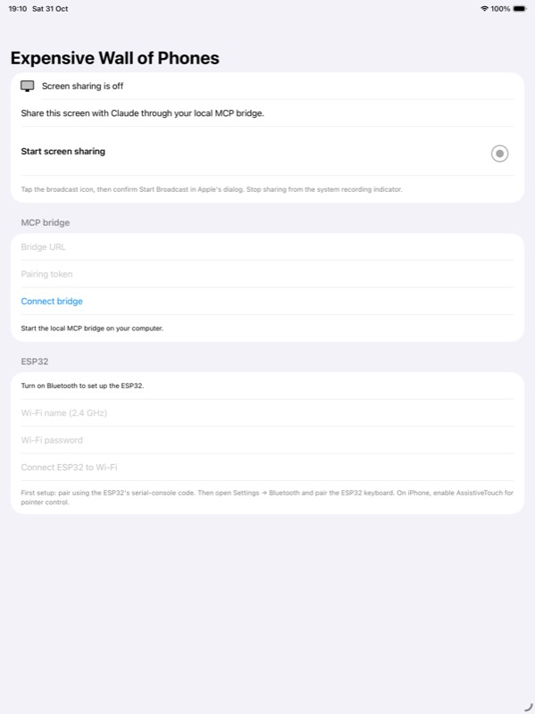
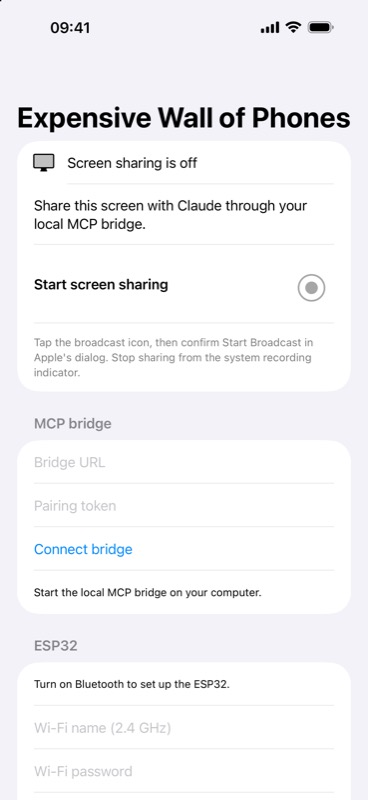

# Prototype verification

Tested on 31 October 2026. Passing a build does not establish that pairing, screen capture, or input works on a physical target.

| Check | Evidence | Result |
| --- | --- | --- |
| Board identification | CP2102 at `/dev/cu.usbserial-0001`; esptool chip and flash queries | ESP32-D0WDQ6 revision 1, 4 MB flash |
| Firmware compilation | PlatformIO `esp32dev` on Windows Maxis, source `2d02358` (GATT registration fix) | Passed; 1,096,017 bytes flash and 57,036 bytes RAM |
| Companion simulator build and launch | Existing iPad Air 13 M3 and iPhone 16 Pro Max simulators on Mac | Passed |
| Companion physical build, install, launch | Connected iPad Air 13 M3, UOA development signing | Passed |
| Invalid companion connection | Connect with missing URL/token | Clear validation message; capture remained off |
| Frame receiver unit tests | Authentication, browser-origin rejection, image size/format, orientation, freshness, restart, stop | Passed on Windows Maxis |
| MCP stdio round trip | Real SDK client against a child server: initialization, six tool schemas, frame image response, new-frame wait and stop | Passed on Windows Maxis; eight tests total, including truncated pixel data and oversized JPEG headers |
| Firmware flash | Physical DevKitC V4; 115200 baud, flash hashes verified by esptool | Passed without erasing NVS |
| BLE advertisement | Read-only scan on Mac | HID and EWP service UUIDs advertised; physical signal observed |
| BLE Wi-Fi provisioning, HID keyboard/pointer, physical ReplayKit upload | Requires the initial pairing, Wi-Fi entry and broadcast confirmation | Not yet verified |
| Multi-host switching or automatic capture bootstrap | No supported implementation in this version | Not implemented |

Only public-safe simulator screenshots are included. No personal device screen, pairing code, token, or original flash backup is published.

## Changed interface

The companion connection/share screen is new and has no prior equivalent. The iPad and iPhone show the same form at their respective viewports. The system broadcast dialog belongs to iOS and is not a custom replacement.

| Before | After |
| --- | --- |
| New page; no prior iPad equivalent. |  |
| New page; no prior iPhone equivalent. |  |

## API references

- [Espressif ESP32-DevKitC V4](https://docs.espressif.com/projects/esp-dev-kits/en/latest/esp32/esp32-devkitc/user_guide.html)
- [Espressif Bluetooth HID device APIs](https://docs.espressif.com/projects/esp-idf/en/stable/esp32/api-reference/bluetooth/esp_hidd.html)
- [Apple pointer devices with AssistiveTouch](https://support.apple.com/en-gb/111775)
- [Apple local network privacy](https://developer.apple.com/documentation/technotes/tn3179-understanding-local-network-privacy)
- [Apple ReplayKit broadcast picker](https://developer.apple.com/documentation/replaykit/rpsystembroadcastpickerview)
- [MCP Python SDK](https://github.com/modelcontextprotocol/python-sdk)

The installed iOS 27.1 SDK marks the ScreenCaptureKit sharing picker as available on iOS 27 and later. ReplayKit remains the prototype's capture implementation for its iOS 17 deployment target.

## Switching one ESP32 between phones

This is feasible to investigate, rather than an established limitation of the chip. The pinned [NimBLE 2.3.6 device API](https://github.com/h2zero/NimBLE-Arduino/blob/2.3.6/src/NimBLEDevice.h) can enumerate stored bonded peers and manage its allowlist. Its [advertising API](https://github.com/h2zero/NimBLE-Arduino/blob/2.3.6/src/NimBLEAdvertising.h) accepts a directed peer address. These provide the pieces for selecting a bonded target, disconnecting the current connection, and advertising to the selected host while retaining its bond.

That design is an inference from the APIs, not a successful iOS host-switch test. A BLE peripheral advertises; the phone's central decides whether and when to reconnect. Apple's [Core Bluetooth connection guidance](https://developer.apple.com/library/archive/documentation/NetworkingInternetWeb/Conceptual/CoreBluetooth_concepts/BestPracticesForInteractingWithARemotePeripheralDevice/BestPracticesForInteractingWithARemotePeripheralDevice.html) describes central-side reconnection. The system HID stack, locked-device behavior, address privacy and competition from another previously paired host need physical tests with two targets.

Current EWP firmware sends notifications only to one authenticated, subscribed connection and rejects a second HID subscriber. It exposes no host-switch MCP tool. Before adding one, acceptance must show that A→B→A preserves both bonds, input reaches only the selected phone, and a sleeping or unavailable target produces a clear failure instead of routing input to another host.
